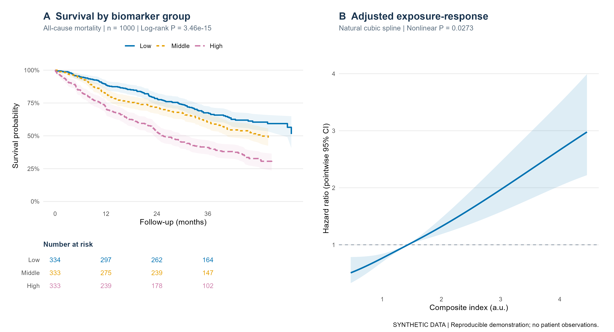
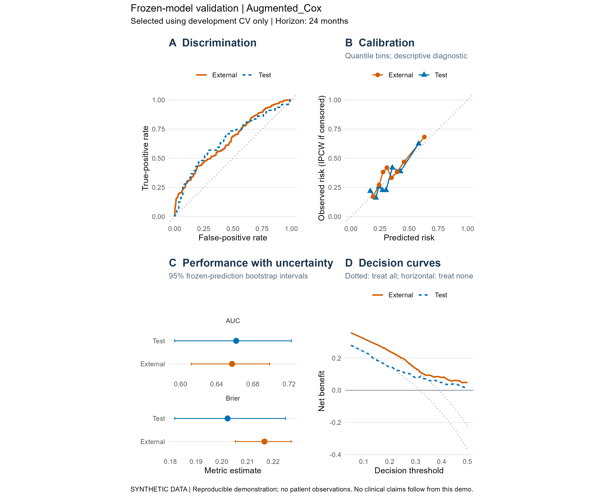
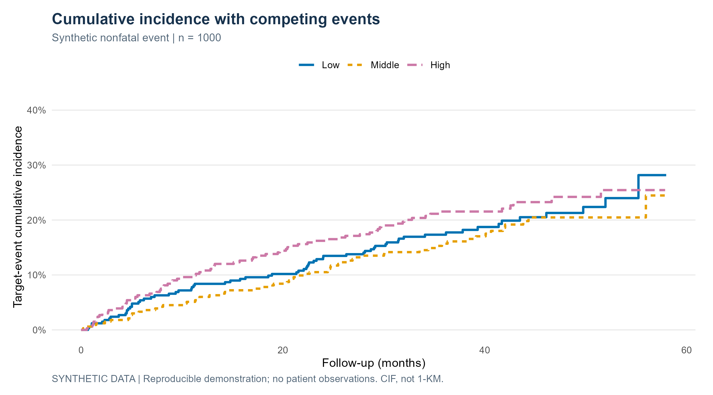
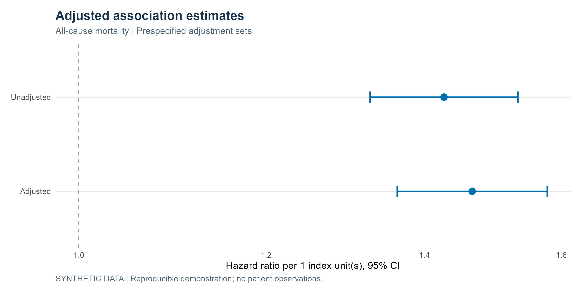

# 复合指标预后研究：分析与论文写作

## ① 简介

面向复合生物标志物的临床预后研究，提供两个可独立使用的 skill：

| Skill | 用途 |
| --- | --- |
| [预后分析](SKILL.md) | 数据核查、生存分析、预测建模与验证，输出结果表、图和结果清单 |
| [论文写作](skills/composite-biomarker-prognosis-writing/SKILL.md) | 文献准备、研究定位、逐章起草、图表说明、语言润色与全文复核 |

支持比值、乘积和评分指标。可以先分析再写作，也可以直接使用已有研究结果进行写作。

## ② 如何安装和使用

### 安装到 Codex

**方式一：让 Codex 安装。** 在 Codex 中发送下面这段话，可只保留需要的一个 skill：

```text
$skill-installer
请从 https://github.com/BoBolol-CN/composite-biomarker-prognosis-analysis 安装两个独立 skill 到 ~/.agents/skills：
1. composite-biomarker-prognosis-analysis：入口在仓库根目录，保留其 agents、assets、references、scripts、docs 和 tests，不把 skills 子目录嵌套安装进去。
2. composite-biomarker-prognosis-writing：来源为 skills/composite-biomarker-prognosis-writing，完整保留该目录。
```

**方式二：手动安装。** [下载 ZIP](https://github.com/BoBolol-CN/composite-biomarker-prognosis-analysis/archive/refs/heads/main.zip) 并解压：

- 在用户的 skills 目录下新建 `composite-biomarker-prognosis-analysis`，复制仓库根目录的 `SKILL.md` 和 `agents/`、`assets/`、`references/`、`scripts/`、`docs/`、`tests/`。
- 将仓库里的 `skills/composite-biomarker-prognosis-writing/` 整个文件夹复制到同一个 skills 目录下。

用户级安装位置为 `~/.agents/skills/`（Windows：`%USERPROFILE%\.agents\skills\`）；仅用于某项目时可放进该项目的 `.agents/skills/`。Codex 会自动发现，未显示时重启。参见 [OpenAI 官方安装说明](https://learn.chatgpt.com/docs/build-skills#where-codex-loads-local-skills)。

### 调用示例

**预后分析：**

```text
使用 $composite-biomarker-prognosis-analysis，
阅读我的方案和数据字典，分析该指标与主要结局的关联，
核对模型诊断，输出表图和可交给写作的结果清单。
```

**论文写作：**

```text
使用 $composite-biomarker-prognosis-writing，
阅读已有方案、结果表和图，完成文献准备及研究主线，
按目标期刊起草论文，标明待补信息。
```

写作 skill 不需要 R。运行分析脚本需要 R 4.4+；先在下载或克隆的仓库根目录运行模拟示例：

```sh
git clone https://github.com/BoBolol-CN/composite-biomarker-prognosis-analysis.git
cd composite-biomarker-prognosis-analysis
Rscript scripts/install_dependencies.R --tests
Rscript scripts/make_demo.R
```

## ③ 预后分析流程

1. **明确研究问题**：人群、指标公式与单位、时间零点、主次结局、随访及预测时距。
2. **核查数据**：变量映射、重复记录、缺失、异常值与事件先后，生成描述表。
3. **开展关联分析**：按问题选择 Cox、KM/CIF、样条及必要的交互和敏感性分析，检查模型诊断。
4. **预测与验证（需要时）**：在开发数据内完成预处理、模型选择与训练，冻结流程后评价测试集或外部队列。
5. **整理输出**：表图、诊断、模型和结果清单，供复核及后续写作使用。

```text
研究定义与数据核查
        ↓
描述与预后关联分析 → 诊断及必要敏感性分析
        ↓
预测建模与独立评价（按研究目标选择）
        ↓
结果表、图、诊断与 results_manifest.csv
```

换成自己的数据时，复制并修改 [配置示例](assets/config.example.R)，填写数据路径、列名、指标公式、终点与模型，再运行：

```sh
Rscript scripts/run_analysis.R path/to/study-config.R
```

详细方法与已支持范围见 [R 工作流说明](references/r-execution.md)。

## ④ 预后分析流程图例

以下图片均由**模拟数据**生成，用于展示输出样式。

### 生存曲线与非线性关系



### 预测模型评价



### 竞争风险与调整后效应

| 累积发生函数 | 效应估计 |
| --- | --- |
|  |  |

## ⑤ 写作流程

```text
读取方案、真实方法与结果 → 建立来源清单
        ↓
三类文献 → 核心对标 → 研究贡献与全文主线
        ↓
题目/关键词 → Introduction → Methods → Results
        ↓
Discussion → 局限与结论 → Abstract
        ↓
章内复核 → 语言润色 → 全文审稿与修改
```

完整写作按上述顺序推进，也支持只写一个章节或仅做润色。可接收分析模块的结果清单，也可直接读取其他软件生成的表格、图和研究材料。

- [写作前准备](skills/composite-biomarker-prognosis-writing/references/writing-preparation.md)：文献证据表、对标选择、研究贡献与写作计划。
- [逐章写作指南](skills/composite-biomarker-prognosis-writing/references/manuscript-workflow.md)：各段如何展开、Methods 小节、结果呈现、讨论逻辑及全文审稿。
- [结果交接与溯源](skills/composite-biomarker-prognosis-writing/references/result-handoff.md)：核对实际方法、数字、来源和解释限制。

## ⑥ 其他注意事项

- 方法按研究设计选择；生存删失和竞争事件需恰当处理，最终测试或外部数据不用于反复调参。
- 论文只报告实际方法和有依据的结果；研究数据、患者标识及逐行预测留在受控研究目录。
- 模拟示例与软件检查不等于临床验证；XGBoost/LightGBM 为可选适配器，尚未在本项目环境中测试。
- 复杂因果中介、重复事件等尚未封装为自动模块；具体范围见 [R 工作流说明](references/r-execution.md)。写作指南可独立阅读，安装说明针对 Codex。
